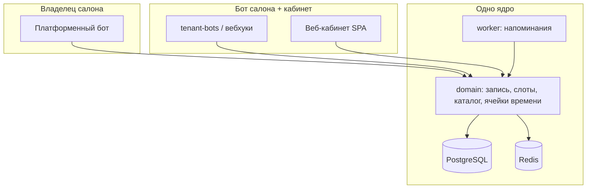

# Beaty

**Свой брендированный канал записи в Telegram** для барбершопов, салонов красоты и частных мастеров (маникюр, косметология, тату и т. п.).

Владелец подключает **собственного бота** из [@BotFather](https://t.me/BotFather); платформа разворачивает его под именем салона. Клиенты записываются **у бота салона**, а не в агрегаторе с конкурентами рядом. Ядро записи, слотов и уведомлений общее для чата и веб-интерфейса.

## Зачем это бизнесу

| Боль | Что даём |
| --- | --- |
| Администратор целый день отвечает в мессенджерах | Запись 24/7 без участия человека |
| Неявки | Напоминания с подтверждением, статусы визита, задел под предоплату |
| Клиенты не возвращаются | Напоминания «пора снова» по интервалу услуги (домен и API готовы) |
| Агрегаторы размывают бренд | Свой бот, свои цвета, своя воронка |
| Непонятна выручка | Загрузка мастеров, финансы и отчёты — в дорожной карте V1/V2 |

Три измеримых обещания продукта: **меньше неявок**, **больше повторных визитов**, **свой бренд в Telegram**. Подробнее о позиционировании и тарифах — в [docs/business.md](docs/business.md).

## Как устроен продукт сейчас



### Два бота

| Бот | Для кого | Задачи |
| --- | --- | --- |
| **Платформенный** (`platform-bot`) | Владелец | Регистрация бизнеса, подключение токена, подписка, системные алерты |
| **Салона** (`tenant-bots`, long polling в проде) | Клиенты, менеджер, мастера | Запись и админка в чате: Reply/Inline-клавиатуры и FSM (aiogram) |

Один Telegram-аккаунт может совмещать роли (владелец-мастер, мастер-клиент). Активная роль переключается и в боте, и в веб-кабинете.

### Веб-кабинет (уже в коде)

Отдельный сервис **`web`** (`app.web.main`, порт **3030**) — mobile-first SPA без сборщика (`backend/app/web/static`). Мультитенантность по адресу `/t/<tenant_public_id>/`.

- **Клиент**: каталог услуг, выбор нескольких услуг, подбор окон по длительности и буферу, «Мои записи».
- **Менеджер**: день из **ячеек времени** (свободные окна мастера с опциональной корректировкой цены и набором услуг), команда, услуги, фото.
- **Специалист**: свой день без прав на создание ячеек.

Вход: одноразовая связка с ботом (`start=web_<code>`) или dev-login локально. Сессия в cookie `bs_<public_id>`.

В прод-стеке контейнер **`web`** уже поднимается рядом с API; на HTTPS-домене через Caddy пока отдаётся в основном API (вебхуки, health) — см. [ближайшие шаги](#ближайший-шаг-telegram-mini-app-и-домен).

### Что в ядре, а не во «фронте»

Вся бизнес-логика живёт в `backend/app/domain` и вызывается и ботом, и REST веб-кабинета:

- мультитенантность (`tenant_id`, шифрование токенов ботов);
- каталог, мастера, графики, движок слотов с тестами;
- статусы записи, удержание слота, журнал аудита;
- **ячейки времени** для менеджерского дня и подбор услуг в свободные сегменты;
- планировщик уведомлений (воркер Taskiq);
- API фаз P2 (отзывы, waitlist, курсы, маркетинг, биллинг) — домен и маршруты есть, UI частично в боте.

Публичный REST `/api/v1` для внешних интеграций по умолчанию **выключен** (`ENABLE_PUBLIC_API=false`).

## Ближайший шаг: Telegram Mini App и домен

Текущая веб-SPA — **готовый UI-слой**, который планируется открывать как **Telegram Mini App** с **собственным HTTPS-доменом** (кнопка «Открыть запись» в боте салона + ссылка с Яндекс.Карт и соцсетей).

В коде уже есть задел:

- проверка подписи `WebAppData` в [backend/app/core/telegram_auth.py](backend/app/core/telegram_auth.py);
- настройка `TENANT_UI_MODE=bot|miniapp|both` в [backend/app/core/settings.py](backend/app/core/settings.py) (сейчас Mini App в рантайме отключён заглушкой [backend/app/bot/miniapp.py](backend/app/bot/miniapp.py));
- prod-переменные `PUBLIC_DOMAIN`, `PUBLIC_HTTPS_URL`, профиль [docker-compose.tls.yml](docker-compose.tls.yml) + [deploy/Caddyfile](deploy/Caddyfile).

План доработки (без смены доменной модели):

1. Проксировать веб-кабинет и статику на домене (Caddy → `web:3030`, API и `/tg/*` — на `api:8000`).
2. Включить Mini App: кнопка `web_app` в боте салона, авторизация через `initData` вместо/вместе с cookie-flow.
3. Включить `WEB_COOKIE_SECURE=true` и единый публичный URL для мультитенантных ссылок `/t/<id>/`.

Детальные сценарии ролей и ограничения Telegram — [docs/product.md](docs/product.md). Техническая схема — [docs/architecture.md](docs/architecture.md). Этапы MVP → V2 — [docs/roadmap.md](docs/roadmap.md).

## Документация

| Файл | Содержание |
| --- | --- |
| [docs/product.md](docs/product.md) | Роли, воронки, жизненный цикл записи, пограничные случаи |
| [docs/architecture.md](docs/architecture.md) | Мультитенантный сервис, стек, данные, слоты, безопасность |
| [docs/business.md](docs/business.md) | Монетизация, онбординг, 152-ФЗ, метрики |
| [docs/roadmap.md](docs/roadmap.md) | MVP / V1 / V2 и статус фаз в коде |
| [docs/bot-only-concept.md](docs/bot-only-concept.md) | Упрощённая «chat-first» модель (исторически; веб-кабинет развивается параллельно) |
| [docs/pilot-checklist.md](docs/pilot-checklist.md) | Чеклист пилота |
| [docs/sales-call-script.md](docs/sales-call-script.md) | Скрипт звонка салонам |

## Стек

Python 3.12, **aiogram 3**, **FastAPI**, **PostgreSQL 16**, **Redis**, **Taskiq**, S3-совместимое хранилище (MinIO локально). Один backend-образ обслуживает `api`, `web`, `worker`, `platform-bot`, `tenant-bots`.

## Локальная разработка

1. Скопируйте [.env.example](.env.example) в `.env`, при необходимости задайте `PLATFORM_BOT_TOKEN`.
2. `make up` — PostgreSQL, Redis, MinIO.
3. `make backend-install && make migrate`
4. Терминалы (по необходимости):
   - `make dev-api` — API на `:8000` (health, webhook);
   - `make dev-web` — веб-кабинет на `http://localhost:3030` (`/t/demo/` после `make seed`);
   - polling ботов — отдельные команды из `backend` (см. [docs/pilot-checklist.md](docs/pilot-checklist.md)).
5. `make test` / `make lint` — pytest, ruff, mypy.
6. `make seed` — демо-тенант `demo` с мастерами, услугами и ячейками.

Структура: `backend/app/` — `domain`, `bot`, `platform_bot`, `web`, `workers`, `api`, миграции Alembic в `backend/migrations/`.

### Переменные веб-кабинета

| Переменная | Назначение |
| --- | --- |
| `WEB_UI_PORT` | Порт (по умолчанию 3030) |
| `WEB_DEFAULT_TENANT` | Публичный id тенанта для `/` без префикса |
| `WEB_DEV_LOGIN` / `ENVIRONMENT` | Тестовый вход по user id (не в production по умолчанию) |
| `MEDIA_DIR` | Загрузки фото |
| `WEB_COOKIE_SECURE` | Обязательно `true` за HTTPS на домене |

## Деплой (production)

CI/CD: [.github/workflows/deploy.yml](.github/workflows/deploy.yml) — тесты, затем SSH на сервер, `scripts/redeploy.sh` и [docker-compose.prod.yml](docker-compose.prod.yml).

Контейнеры compose-проекта `beaty`:

| Сервис | Роль |
| --- | --- |
| `postgres`, `redis` | Данные и очереди |
| `api` | Миграции при старте, webhook, health (`WEB_PORT`, по умолчанию 4040) |
| `web` | Веб-кабинет (`WEB_UI_PORT`, по умолчанию 3030) |
| `worker` | Напоминания и фоновые задачи |
| `platform-bot` | Онбординг владельцев |
| `tenant-bots` | Long polling ботов салонов |

Секреты GitHub Actions: `SSH_HOST`, `SSH_USER`, `SSH_PRIVATE_KEY`, `TELEGRAM_SECRET`, опционально `TELEGRAM_PROXY`. `POSTGRES_PASSWORD`, `TOKEN_ENCRYPTION_KEY`, `JWT_SECRET` генерируются на сервере в `/root/beaty/.secrets.env` — файл не удалять.

Обновление кода на VPS — **только через CI**; ручной `git pull` с HTTPS обычно падает без deploy-токена.

Логи на сервере:

```bash
cd ~/beaty
docker compose logs -f --tail=200
docker compose ps
```

Эквивалент: `scripts/logs.sh`, `scripts/compose-prod.sh`.

Опциональный TLS: `docker-compose.tls.yml` + Caddy; задайте `PUBLIC_DOMAIN` и `ACME_EMAIL` в `.env.prod`.

Перед выкладкой Mini App на домен — [docs/pilot-checklist.md](docs/pilot-checklist.md).