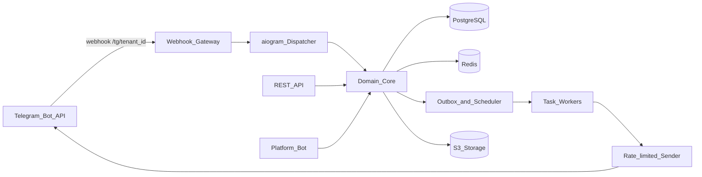
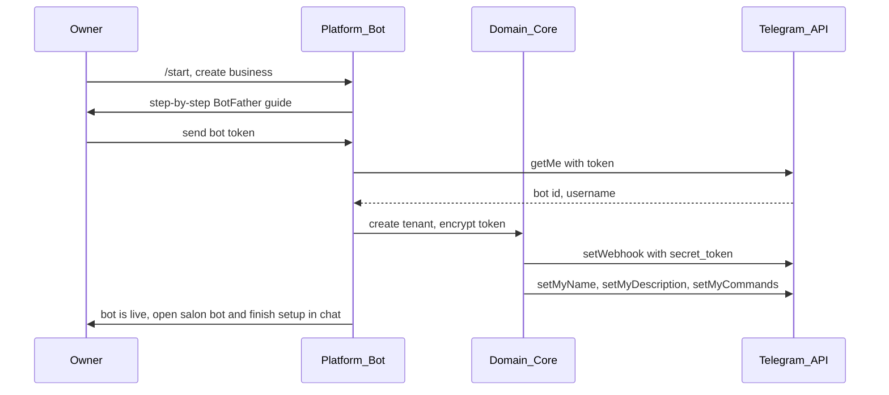
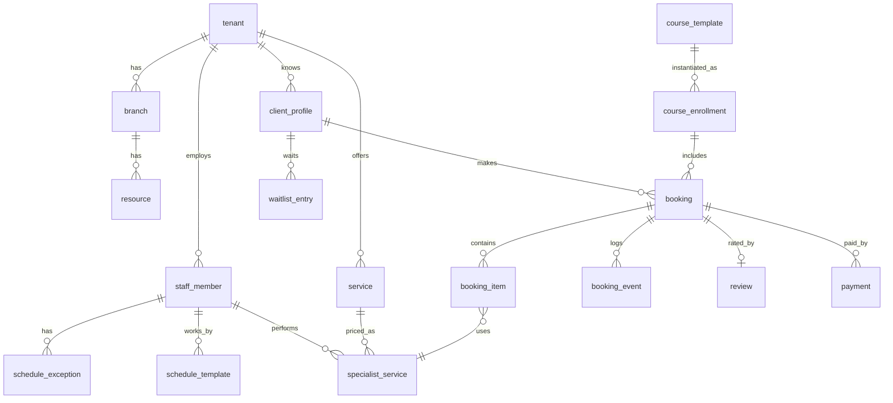

# Техническая архитектура

## 1. Ключевое решение: один мультитенантный сервис вместо контейнера на каждого бота

Исходная идея — поднимать отдельный Docker-контейнер на каждый токен. От неё стоит отказаться:

| | Контейнер на бота | Мультитенантный сервис |
| --- | --- | --- |
| Ресурсы | ~100–200 МБ RAM на каждого клиента, даже если у салона 3 записи в день | Общий пул, затраты растут с нагрузкой, а не с числом клиентов |
| Обновления и миграции БД | Раскатывать N раз, версии расходятся | Один деплой |
| Подключение нового бизнеса | Оркестрация контейнера, секунды–минуты | Строка в БД и `setWebhook`, мгновенно |
| Мониторинг | N процессов | Один сервис, метрики с меткой `tenant_id` |
| Изоляция | Сильная | Логическая (`tenant_id` + Row Level Security) |

Telegram сам маршрутизирует обновления: у каждого бота свой вебхук `https://api.<домен>/tg/{tenant_public_id}`. Сервис по URL понимает, какому бизнесу пришло обновление, и обрабатывает его в контексте этого тенанта.

Отдельный инстанс (своя БД и свои контейнеры) остаётся опцией тарифа Enterprise для сетей с требованиями к изоляции. Код при этом тот же — просто развёрнут с одним тенантом.

## 2. Компоненты



- **Webhook Gateway** (FastAPI): проверяет `X-Telegram-Bot-Api-Secret-Token`, отбрасывает дубликаты по `update_id`, сразу отвечает `200` и отдаёт обновление на обработку. Долгая обработка в вебхуке приводит к повторным доставкам от Telegram.
- **aiogram Dispatcher**: один диспетчер на все боты. Экземпляры `Bot` создаются по тенанту и кэшируются, обновление передаётся через `dispatcher.feed_update(bot, update)`. Middleware кладёт в контекст тенанта, пользователя и его роли. Весь пользовательский UI — Reply/Inline-клавиатуры и FSM.
- **REST API** (FastAPI): по умолчанию отключён (`ENABLE_PUBLIC_API=false`); остаются health/ready и webhook. Основной интерфейс — только бот бизнеса.
- **Platform Bot**: наш собственный бот для владельцев — онбординг, подключение токена, подписка, поддержка, системные оповещения («токен отозван»).
- **Domain Core**: вся бизнес-логика (запись, слоты, курсы, уведомления, финансы) в виде сервисов без знания о Telegram. Бот — тонкий интерфейс к ядру.
- **Outbox и планировщик**: события домена и запланированные уведомления пишутся в БД в той же транзакции, что и изменение данных, а воркеры их отправляют.
- **Rate-limited Sender**: единственное место, которое отправляет сообщения в Telegram. Соблюдает лимиты, обрабатывает `429 retry_after`, `403`, `401`.

## 3. Стек

| Слой | Выбор | Почему |
| --- | --- | --- |
| Язык | Python 3.12 | По исходному плану, хорошая экосистема для ботов |
| Telegram | aiogram 3 | Асинхронный, много ботов в одном процессе, FSM, middleware, вебхуки. Синхронный `requests` не масштабируется на сотни ботов |
| HTTP API | FastAPI + Pydantic | Асинхронный, OpenAPI из коробки |
| БД | PostgreSQL 16 | Транзакции, exclusion constraints для защиты от двойной записи, RLS, `tstzrange` |
| ORM и миграции | SQLAlchemy 2 (async) + Alembic | Стандарт для FastAPI |
| Кэш и состояния | Redis | FSM aiogram, удержание слотов, rate limiting, кэш слотов, дедупликация `update_id` |
| Фоновые задачи | Taskiq (или Arq) на Redis | Асинхронные, нативно дружат с asyncio |
| UI | aiogram FSM + Reply/Inline keyboards | Единственный пользовательский интерфейс в чате |
| Файлы | S3-совместимое хранилище (Yandex Object Storage, Selectel) | Фото мастеров, клиентов, портфолио |
| Наблюдаемость | Sentry, Prometheus + Grafana, структурные логи | Метрики и ошибки с меткой тенанта |
| Деплой | Docker Compose на старте, затем Kubernetes или несколько VM | Сервисы без состояния масштабируются горизонтально |

## 4. Подключение бизнеса (онбординг)



Детали:

- Перед сохранением токена проверяем, что бот не подключён к другому тенанту (по `bot_id` из `getMe`).
- Сообщение с токеном в чате платформенного бота удаляем сразу после чтения.
- Если у бота уже был вебхук или он работал через `getUpdates`, предупреждаем, что мы перехватим обновления.
- Смена токена (`/revoke` в BotFather) — владелец присылает новый токен, мы обновляем шифрованное значение и переустанавливаем вебхук. Если `bot_id` новый, это перенос на другого бота, см. [product.md](product.md).
- Мастер-одиночка после подключения проходит короткий мастер настройки **в боте салона** (FSM): услуги, график, бренд. Владелец автоматически становится и менеджером, и мастером.

## 5. Мультитенантность и изоляция

- Каждая бизнес-таблица содержит `tenant_id`. Все запросы идут через репозитории, которые требуют тенанта в контексте.
- Дополнительно включается **Row Level Security** в PostgreSQL: сессия БД выставляет `SET app.tenant_id = …`, политики не пускают к чужим строкам даже при ошибке в коде.
- Ключи в Redis и S3 имеют префикс тенанта.
- Ограничение нагрузки по тенанту (rate limit на API и бот), чтобы один крупный клиент или атака на его бота не влияли на остальных.

## 6. Модель данных



Основные таблицы:

| Таблица | Назначение и ключевые поля |
| --- | --- |
| `tenant` | Бизнес: название, бренд (цвета, логотип, тон), `bot_id`, `bot_username`, зашифрованный токен, `webhook_secret`, настройки правил, статус подписки |
| `branch` | Филиал: адрес, геоточка, часовой пояс, часы работы, праздники |
| `user_account` | Telegram-пользователь платформы: `telegram_user_id`. Один на всю платформу, без бизнес-данных |
| `staff_member` | Сотрудник тенанта: ссылка на `user_account` (может быть пустой, пока не принял приглашение), роли, профиль, фото, схема выплат |
| `client_profile` | Клиент в конкретном тенанте: имя, телефон, фото, день рождения, согласия, источник, неявки, теги, флаг «недоступен в Telegram». `user_account_id` пуст у офлайн-клиентов |
| `service`, `service_category` | Каталог: базовая цена и длительность, буфер, интервал «пора снова», нужный тип ресурса |
| `specialist_service` | Какие услуги делает мастер, его цена и длительность |
| `resource` | Кресло, кабинет, аппарат |
| `schedule_template`, `schedule_exception` | График мастера и исключения (отпуск, больничный, разовая смена, блокировка) |
| `booking` | Запись: клиент, филиал, статус, источник, комментарий, дедлайн отмены, итоговая цена со скидкой, `course_enrollment_id` |
| `booking_item` | Одна услуга в записи: мастер, ресурс, `during tstzrange`, зафиксированные цена и длительность |
| `booking_event` | Журнал по записи: создание, перенос (старое и новое время), отмена (кто, почему), смена статуса |
| `course_template`, `course_enrollment` | Шаблон курса и купленный курс клиента с прогрессом и сроком действия |
| `waitlist_entry` | Лист ожидания: услуга, мастер или «любой», желаемый диапазон дат (миграция **002**) |
| `review` | Оценки мастеру и салону, текст, фото, ответ бизнеса, статус модерации |
| `promotion`, `promo_code`, `loyalty_rule` | Маркетинг |
| `payment` | Факт оплаты: сумма, способ, скидка, чаевые, внешний ID платежа |
| `payout_rule`, `payout` | Схемы и выплаты мастерам |
| `notification` | Запланированные и отправленные сообщения: тип, получатель, `send_at`, статус, ключ идемпотентности |
| `audit_log` | Кто, что и когда изменил |
| `subscription`, `invoice` | Наша подписка с бизнеса |

Деньги храним в копейках (`bigint`) с кодом валюты, время — в `timestamptz` (UTC), часовой пояс берётся из филиала.

## 7. Защита от двойной записи

Пересечения запрещены на уровне БД, а не только проверкой в коде:

```sql
CREATE EXTENSION IF NOT EXISTS btree_gist;

ALTER TABLE booking_item
  ADD CONSTRAINT no_specialist_overlap
  EXCLUDE USING gist (specialist_id WITH =, blocked_during WITH &&)
  WHERE (is_active);

ALTER TABLE booking_item
  ADD CONSTRAINT no_resource_overlap
  EXCLUDE USING gist (resource_id WITH =, blocked_during WITH &&)
  WHERE (is_active AND resource_id IS NOT NULL);
```

- `blocked_during` — время услуги плюс буфер после неё.
- `is_active` — истина для статусов `held`, `booked`, `confirmed`, `arrived`. Отмена или неявка освобождают время.
- Удержание слота — это запись в статусе `held` с `hold_expires_at`. В условии ограничения нельзя использовать `now()`, поэтому в той же транзакции перед вставкой просроченные пересекающиеся удержания переводятся в неактивные, а фоновая задача регулярно чистит остальные.
- При конфликте (`exclusion_violation`) клиент получает «время только что заняли» и ближайшие альтернативы.

## 8. Алгоритм расчёта слотов

Вход: тенант, филиал, набор услуг, мастер (или «любой»), диапазон дат.

1. Для каждого подходящего мастера строим **рабочие интервалы** на каждый день: шаблон графика минус исключения, перерывы, праздники филиала. Расчёт идёт в локальном времени филиала, затем переводится в UTC — так корректно обрабатывается переход на летнее время.
2. Вычитаем **занятые интервалы**: активные `booking_item` (с буферами) и блокировки.
3. Если услуге нужен ресурс, пересекаем со свободными интервалами ресурсов этого типа.
4. Нарезаем свободные интервалы по **шагу сетки** (15/30 минут) и оставляем те старты, где помещается суммарная длительность услуг у этого мастера.
5. Для цепочки услуг у разных мастеров ищем последовательность: конец первой услуги совпадает с началом второй (или укладывается в допустимый зазор).
6. Применяем правила тенанта: минимальное время до записи, горизонт записи, ограничения для клиента (например, предоплата после неявок).
7. Для «любого мастера» объединяем слоты и помечаем, какой мастер будет назначен по правилу (наименьшая загрузка, рейтинг, ротация).

Результат кэшируется в Redis на короткое время по ключу (тенант, мастер, день) и сбрасывается при любом изменении записей или графика этого мастера.

Модуль слотов — чистые функции без доступа к БД и Telegram, с подробными юнит-тестами: переход на летнее время, записи около полуночи, услуги длиннее рабочего окна, цепочки мастеров, ресурсы, буферы.

## 9. Уведомления

- При создании или изменении записи в той же транзакции создаются строки `notification` с `send_at` (напоминания, запрос отзыва, «пора снова»). При переносе старые отменяются, новые создаются; при отмене — отменяются все.
- Планировщик раз в минуту забирает созревшие уведомления (`SELECT … FOR UPDATE SKIP LOCKED`) и ставит их в очередь.
- Перед отправкой проверяется актуальность: запись не отменена, клиент не отписался, сейчас не тихие часы (иначе `send_at` сдвигается).
- Ключ идемпотентности (`booking_id + тип`) не даёт отправить одно напоминание дважды при повторе задачи.
- **Sender** соблюдает лимиты Telegram на бота (~30 сообщений в секунду) и на чат (~1 в секунду), разбирает `429 retry_after`. Рассылки идут в отдельной очереди с низким приоритетом, чтобы не задерживать напоминания.
- `403` (бот заблокирован) — клиент помечается недоступным, менеджер получает сигнал. `401` (токен отозван) — тенант переводится в статус «бот отключён», владелец получает сообщение в платформенном боте.
- Дайджесты персонала собираются по расписанию в часовом поясе филиала.

## 10. Bot UI (вместо веб-фронта)

- Идентификация пользователя — из Telegram update (`telegram_user_id`); отдельный WebApp `initData` для UX не нужен.
- Роль и меню собираются на бэкенде по тенанту. У мастера-одиночки — одно смешанное меню без переключателя ролей.
- Клиентский сценарий записи: FSM + inline-пагинация каталога/слотов → `hold_slot` / `confirm_hold` в Domain Core.
- Напоминания и форс-мажор приходят сообщениями с inline-кнопками (`confirm_visit:…`, `fm:…`).
- Веб-кабинет ресепшена — только V2; до этого менеджер работает списками и командами в боте.

## 11. Безопасность

- Токены ботов шифруются в БД (Fernet, ключ в секрет-хранилище или KMS), никогда не попадают в логи и ошибки Sentry (фильтры).
- Каждый вебхук имеет случайный `secret_token`, запросы без него отбрасываются.
- Права проверяются в доменном слое, а не только в интерфейсе. Плюс RLS в БД.
- Фото клиентов — в приватном бакете, доступ по подписанным ссылкам с коротким сроком.
- Номера телефонов показываются только ролям, которым они нужны. В логах номера маскируются.
- Журнал аудита для всех изменений персонала.
- Бэкапы БД ежедневно плюс WAL-архивирование, регулярная проверка восстановления.
- Данные хранятся в РФ (требование 152-ФЗ), см. [business.md](business.md).

## 12. Надёжность и эксплуатация

- Gateway, API и воркеры — без состояния, масштабируются горизонтально.
- Дедупликация `update_id` в Redis защищает от повторной доставки обновлений.
- Если Telegram помечает вебхук как недоступный (`getWebhookInfo` с ошибками), фоновая проверка переустанавливает его и сообщает нам.
- Метрики: задержка обработки обновлений, очередь уведомлений, ошибки отправки по типам, конверсия воронки записи, всё с меткой тенанта.
- Окружения: local (Docker Compose), staging с тестовыми ботами, production.
- CI: линтеры (ruff, mypy), юнит-тесты ядра и модуля слотов, интеграционные тесты с PostgreSQL в контейнере, миграции проверяются на каждом PR. Сборки фронтенда нет.

## 13. Предлагаемая структура репозитория

```text
backend/
  app/
    core/            # конфигурация, БД, Redis, безопасность
    domain/          # сущности и сервисы: booking, slots, courses, reviews, finance
    bot/             # aiogram: роутеры клиента, мастера, менеджера; keyboards; FSM
    platform_bot/    # онбординг и подписка
    api/             # FastAPI (служебный / V2 web)
    workers/         # планировщик, отправка уведомлений, рассылки
  migrations/
  tests/
docker-compose.yml
docs/
```
