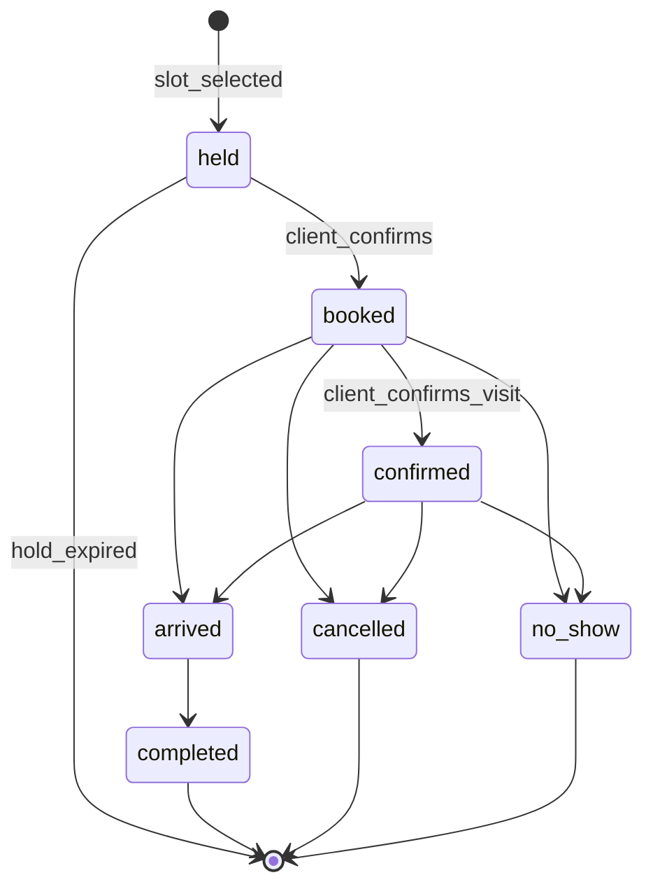

# Продукт: роли, сценарии, пограничные случаи

## 1. Позиционирование

Главный конкурент — не CRM, а **администратор в мессенджере плюс тетрадка**, а также бесплатные агрегаторы (DIKIDI) и тяжёлые CRM (YCLIENTS, Altegio). Мы продаём три измеримых результата:

1. **Меньше неявок** — напоминания с подтверждением, учёт неявок, предоплата.
2. **Больше повторных визитов** — напоминание «пора снова» по интервалу каждой услуги.
3. **Свой бренд** — клиент общается с ботом салона, а не с агрегатором.

Целевые сегменты по приоритету:

- **Мастер-одиночка** (самый массовый). Владелец, менеджер и специалист — один человек. Онбординг должен занимать около 5 минут, а интерфейс не должен заставлять переключаться между ролями.
- **Небольшой салон или барбершоп** (2–10 мастеров, 1 администратор).
- **Сеть** (несколько филиалов) — позже.

## 2. Роли и права

Один Telegram-аккаунт может иметь несколько ролей одновременно: владелец-мастер, мастер, который сам записывается к коллеге, и т. п.

| Возможность | Владелец | Менеджер | Ресепшен | Мастер | Клиент |
| --- | --- | --- | --- | --- | --- |
| Подписка, токен, удаление бизнеса | да | — | — | — | — |
| Персонал, права | да | да | — | — | — |
| Услуги, цены, графики всех мастеров | да | да | — | — | — |
| Свой график, блокировка времени | да | да | — | да (по настройке — с подтверждением менеджера) | — |
| Записи всех мастеров | да | да | да | — | — |
| Свои записи | да | да | да | да | свои |
| Финансы и выплаты | да | да | — | только свои | — |
| Акции, новости, рассылки | да | да | — | — | — |
| Ответы на отзывы | да | да | — | на свои | — |
| Журнал действий | да | да | — | своё | своё |

Все чувствительные действия пишутся в журнал аудита: кто, когда и что изменил (запись, цену, график, права).

## 3. Точки входа

Бот не может написать человеку первым, поэтому вход в бота — отдельная продуктовая задача:

- Deep links: `t.me/<bot>?start=master_12` (сразу к мастеру), `?start=service_5`, `?start=promo_SPRING`, `?start=ref_<client_id>` (реферальная ссылка).
- QR-коды на ресепшене, зеркале, визитках мастеров, чеке. Генерируются в админке.
- Кнопка «Записаться» для Instagram, VK, Яндекс.Карт и 2ГИС — всегда ссылка на бота (`t.me/<bot>?start=…`).
- Источник каждого клиента сохраняется, чтобы бизнес видел, какой канал приводит людей.

## 4. Клиент

### 4.1 Регистрация

1. `/start` — приветствие в тоне бренда, согласие на обработку персональных данных (ссылка на политику бизнеса).
2. Имя (подставляется из Telegram, можно поправить).
3. Телефон через кнопку `request_contact` — номер подтверждён Telegram, вводить вручную не нужно.
4. Необязательно: фото (видно мастеру и менеджеру), дата рождения (для поздравлений и акций), согласие на маркетинговые рассылки — отдельной галочкой.

Если менеджер раньше завёл этого человека как «офлайн-клиента» с тем же номером, профили склеиваются, и вся история визитов сохраняется.

Клиент может в любой момент изменить свои данные, отписаться от маркетинга или запросить удаление данных.

### 4.2 Интерфейс: только чат бота

Весь UI — сообщения, **Reply Keyboard** (постоянное меню роли) и **Inline Keyboard** (выбор внутри шага и действия на карточке). Отдельного веб-приложения нет.

- **Меню клиента**: «Записаться», «Мои записи», «Повторить прошлую», «Профиль».
- **Запись** — пошаговый FSM: услуга → мастер → слот → сводка → подтверждение (пагинация списков inline-кнопками).
- **Уведомления** с быстрыми кнопками в сообщении: «Подтверждаю / Перенести / Отменить», «Записаться снова», «Оставить отзыв».
- **Короткие сценарии** первого класса: «повторить прошлую запись», «ближайшее свободное время у моего мастера».
- Фото мастеров и портфолио — по запросу альбомом в чат; в списках выбора — текстовое превью (имя, рейтинг, цена).

### 4.3 Запись

Клиент может начать с любого из трёх концов:

- **Услуга → мастер → время** (классика).
- **Мастер → услуга → время** (у клиента есть «свой» мастер).
- **Время → услуга → любой мастер** («мне нужно в субботу утром»).

Правила:

- При выборе услуг сразу видны **итоговая цена и длительность**. Цена может отличаться у разных мастеров (топ-мастер дороже) — показываем диапазон «от … до …», а точную цену — после выбора мастера.
- Можно выбрать несколько услуг. Если их делают разные мастера (стрижка, затем окрашивание у колориста), система ищет цепочку слотов подряд.
- Вариант **«Любой мастер»**: система предлагает время, а мастера подбирает по загрузке или рейтингу (правило выбирает бизнес).
- **Запись за другого человека** (ребёнок, мама): указывается имя и, по желанию, телефон. Напоминания приходят тому, кто записывал.
- **Групповая запись** (подружки на маникюр в одно время): несколько записей к разным мастерам на одно время.
- После выбора слот **удерживается на 5–10 минут**, пока клиент подтверждает запись. Никто другой его не займёт.
- Перед подтверждением — сводка: услуги, мастер, адрес, время, цена, правила отмены, комментарий для мастера.
- Если слотов нет — **лист ожидания**: «сообщите, если освободится время в этот день или у этого мастера».

### 4.4 Перенос и отмена

- Бизнес задаёт **дедлайн бесплатной отмены и переноса** (например, за 12 часов). Позже — только через менеджера или с потерей депозита.
- При переносе цена и состав услуг сохраняются, напоминания пересчитываются.
- При отмене освободившийся слот сразу предлагается клиентам из листа ожидания.

### 4.5 Курсы и абонементы

Это не просто «несколько записей», а отдельная сущность — пакет:

- Шаблон курса задаёт бизнес: N сеансов, минимальный и максимальный интервал между ними, срок действия, цена за пакет или за сеанс, допустимые мастера.
- После каждого сеанса клиенту сразу предлагается выбрать время следующего — **по умолчанию у того же мастера** и в рекомендованный интервал.
- Если клиент не выбрал время, напоминаем ближе к сроку.
- Прогресс «3 из 6», предупреждение о скором сгорании пакета, перенос следующего сеанса в рамках интервала.
- **Гибкий курс** (тату-проект): число и длительность сеансов заранее неизвестны, мастер после сеанса сам предлагает длительность следующего.

### 4.6 Отзывы

- Оставить отзыв можно только после визита в статусе «выполнено», один отзыв на визит. Просим через 2–3 часа после визита.
- Оценка мастеру и салону отдельно, текст и фото по желанию.
- Бизнес отвечает публично. **Скрывать отзывы бизнес не может** — только пожаловаться на оскорбления или спам, модерацию проводим мы. Иначе рейтингу нет доверия.
- Оценка 1–3 сразу уходит менеджеру как срочный сигнал, чтобы успеть вернуть клиента. После оценки 4–5 предлагаем продублировать отзыв на Яндекс.Картах или в 2ГИС.
- Клиенты видят рейтинг и отзывы салона и каждого мастера в каталоге.

### 4.7 История

Клиент видит все свои записи — выполненные, отменённые, перенесённые, — курсы, отзывы и оплаты.

## 5. Мастер

- **Мой день / неделя**: список записей с фото клиента, услугами, комментарием, пометкой «новый клиент» или «был N раз».
- Отметки по записи: «пришёл», «не пришёл», «опаздывает», «выполнено», фактическая сумма и способ оплаты (если бизнес разрешил мастеру вносить оплату).
- **Карта клиента**: заметки (формула окрашивания, аллергии, предпочтения), фото «до/после» с согласия клиента, история визитов у этого мастера.
- **Портфолио**: фото работ, которые видят клиенты в каталоге.
- **Управление временем**: заблокировать слот (обед, личное), запросить выходной или изменение графика.
- **Форс-мажор**: «не смогу с … по …» — см. раздел 8.
- Свои оценки, отзывы, начисления и выплаты за период.
- Уведомления только о своих записях: новая, перенос, отмена, клиент подтвердил, клиент опаздывает.

## 6. Менеджер

Основной интерфейс — чат бота: Reply-меню + списки и FSM. Плотный календарь с колонками и drag-and-drop **не копируем**; для салона 2–10 мастеров достаточно ленты по времени и фильтров. Веб-кабинет ресепшена на компьютере — отдельный этап V2, не Mini App.

- **Сегодня / дата**: лента записей по времени или фильтр по мастеру; пустой слот → FSM создания записи.
- **Ручная запись**: по телефону или без Telegram. Можно выбрать существующего клиента или создать «офлайн-клиента» по имени и телефону.
- **Мастера**: профиль, фото (отправка файла), описание, услуги, индивидуальные цены и длительности, график — пошаговые сценарии в чате.
- **Каталог**: категории, услуги, цена, длительность, буфер, интервал «пора снова», нужный ресурс (кабинет, аппарат).
- **Графики**: шаблоны (2/2, пн–пт, свой), исключения (отпуск, больничный, разовая смена), праздники и нерабочие дни салона.
- **Клиенты**: поиск текстом, история, неявки, источник, сегменты, теги, заметки, блокировка (например, после повторных неявок).
- **Акции и новости**: создание, сегментация, планирование, статистика открытий и записей.
- **Финансы**: выручка за период, средний чек, загрузка мастеров, неявки, начисления мастерам по их схемам, отметка «выплачено», экспорт файлом в чат.
- **Настройки бренда**: название, описание, логотип (файл), тон общения («ты» или «вы»), тексты сообщений с превью в чате.
- **Настройки правил**: шаг сетки, горизонт записи, минимальное время до записи, дедлайн отмены, расписание напоминаний, тихие часы.
- Команды и кнопки меню: «сегодня», «свободные окна», «создать запись», «нерешённые»; `setMyCommands` со scope персонала.

### Уведомления персонала

Если сообщать менеджеру «обо всём», он перестанет читать уведомления. Поэтому у уведомлений есть уровни важности:

- **Срочно, сразу**: отмена менее чем за N часов, форс-мажор мастера, нерешённый перенос, плохой отзыв, клиент заблокировал бота перед визитом.
- **Обычно**: новая запись, перенос — сразу или пачкой, по настройке.
- **Дайджест**: утром — «сегодня 14 записей, 2 свободных окна, 3 не подтвердили», вечером — итоги дня.

Каждый сотрудник сам настраивает, что получать мгновенно, а что — в дайджесте.

## 7. Жизненный цикл записи

- **Перенос** — это не отдельный статус, а изменение времени записи с записью в истории (старое время, новое время, кто перенёс).
- **Отмена** хранит инициатора (клиент, мастер, менеджер, система) и причину.
- Цена, состав услуг и длительность **фиксируются в момент записи**: изменение прайса не трогает существующие записи.
- **Неявки** считаются по клиенту. Бизнес может включить правило «после N неявок — запись только с предоплатой» или «только через менеджера».
- **Опоздание**: мастер или клиент («опаздываю на 15 минут») отмечает его. Если следующий слот занят, клиенту предлагается сократить услугу или перенести запись.

Все события по записи хранятся в журнале. Клиент видит то, что касается его, мастер — своё, менеджер — всё.

## 8. Форс-мажор мастера

1. Мастер (или менеджер) отмечает недоступность на интервал: «сегодня с 14:00», «завтра весь день», «больничный до пятницы».
2. Система находит все затронутые записи и для каждой подбирает варианты:
   - другой мастер с той же услугой на то же время;
   - тот же мастер в ближайшее свободное время;
   - отмена.
3. Каждый клиент получает персональное сообщение с этими вариантами кнопками.
4. Менеджер видит панель «нерешённые»: кто ответил, кто нет. Если клиент не ответил за X часов (или до визита осталось мало времени), задача переходит менеджеру — позвонить.
5. Если запись была с предоплатой, она переносится на новую запись или возвращается.

Тот же механизм используется, когда закрывается весь салон (авария, отключение электричества).

## 9. Напоминания и коммуникации

| Сообщение | Когда | Настраивается |
| --- | --- | --- |
| Подтверждение записи | сразу | текст |
| Напоминание с кнопкой «Подтверждаю» | за 24 ч | время, вкл/выкл |
| Короткое напоминание с адресом и картой | за 2 ч | время, вкл/выкл |
| «Скоро ждём» | за 30 мин | вкл/выкл |
| Запрос отзыва | через 2–3 ч после визита | время, вкл/выкл |
| Выбор следующего сеанса курса | после сеанса и ближе к сроку | интервал |
| «Пора снова» | по интервалу услуги | интервал на услугу |
| Поздравление с днём рождения | в день рождения / заранее | текст, скидка |
| Акции и новости | по расписанию рассылки | сегмент |

Правила:

- **Тихие часы**: не отправляем сообщения ночью. Напоминание за 2 часа для записи на 9:00 уходит накануне вечером.
- Если клиент не подтвердил визит за N часов до записи, менеджер получает сигнал «позвонить».
- Сервисные уведомления (о записи) и маркетинговые (акции) разделены: отписка от маркетинга не отключает напоминания.
- Частоту маркетинга ограничиваем (например, не больше 2 рассылок в неделю), чтобы клиенты не блокировали бота.
- «Пора снова» — персонально: «Прошло 4 недели со стрижки у Ивана. Записать на пятницу в 18:00?» с готовой кнопкой.

## 10. Маркетинг и лояльность

- Акции: скидка на услугу или категорию, на период, для сегмента (новые, спящие более 60 дней, постоянные).
- Промокоды: одноразовые и многоразовые, лимит использований, срок действия.
- День рождения: скидка в окне ± N дней.
- Лояльность: каждый N-й визит со скидкой или бонусные баллы.
- Реферальная программа: клиент делится ссылкой, оба получают бонус после первого визита друга.
- Скидки применяются к цене при записи и видны в сводке.

## 11. Пограничные случаи

**Клиенты**

- Клиент заблокировал бота — помечаем его «недоступен в Telegram» и показываем менеджеру: о записи нужно сообщить по телефону.
- Клиент сменил номер или Telegram-аккаунт — менеджер может вручную объединить профили.
- Один человек — клиент нескольких салонов на платформе: профили у каждого салона отдельные, данные между бизнесами не передаются.
- Клиент пытается записаться на несколько пересекающихся слотов — запрещаем или спрашиваем (возможно, это запись за другого человека).
- Клиент с историей неявок — срабатывают правила бизнеса (предоплата или запись через менеджера).
- Клиент удалил данные — его записи остаются в отчётах бизнеса анонимно.

**Расписание**

- Менеджер меняет график, а на это время уже есть записи — показываем конфликты и запускаем сценарий форс-мажора для затронутых.
- Мастер увольняется, а у него будущие записи — нельзя удалить мастера, пока записи не перенесены. Профиль архивируется, история и отзывы сохраняются.
- Изменилась длительность услуги — существующие записи не меняются, новые слоты считаются по-новому.
- Переход на летнее/зимнее время, записи около полуночи, филиалы в разных часовых поясах — всё хранится в UTC, а показывается во времени филиала.
- Праздники и сокращённые дни.
- Одновременная запись двух клиентов на один слот — второй получает «слот только что заняли» и ближайшие альтернативы.

**Бизнес**

- Владелец отозвал токен или удалил бота в BotFather — сразу сообщаем владельцу через платформенный бот, записи и данные сохраняются.
- Владелец хочет поменять бота (новый токен) — переносим всех на новый бот. Клиентам старого бота отправляем сообщение со ссылкой (пока старый токен ещё работает).
- Подписка не оплачена — мягкая деградация, см. [business.md](business.md).
- Менеджер ушёл из салона — владелец отзывает права; меню и команды персонала для этого аккаунта снимаются.

## 12. Ограничения Telegram, влияющие на дизайн

- Бот не может написать первым: клиент должен сам нажать `/start`. Поэтому важны deep links, QR-коды и ручные записи офлайн-клиентов.
- Телефон — только через `request_contact`, тогда он подтверждён Telegram.
- Лимиты отправки: около 30 сообщений в секунду на бота и около 1 в секунду в один чат. Массовые рассылки идут через очередь с ограничением скорости.
- `403 Forbidden: bot was blocked by the user` — клиент недоступен, сообщаем менеджеру.
- `401 Unauthorized` — токен отозван, сообщаем владельцу.
- Аватар бота задаётся вручную в BotFather. Название, описание и команды мы задаём сами через Bot API (`setMyName`, `setMyDescription`, `setMyShortDescription`, `setMyCommands`).
- Команды для персонала видны только персоналу: `setMyCommands` со scope конкретного чата.
- Оплата физических услуг — через Telegram Payments с провайдером (ЮKassa) или ссылку на оплату. Telegram Stars для этого не подходят.
- Telegram Business: владелец с Premium может подключить бота к своему аккаунту, чтобы бот отвечал клиентам в его личных чатах. Это будущая премиум-функция вместе с ИИ-ассистентом.
- Inline-кнопки: короткий `callback_data` (лимит Telegram), длинные списки — пагинация; на шагах FSM предпочтительно `editMessage`, а не поток новых сообщений.
- Reply Keyboard — навигация по разделам; Inline — выбор значения и действие на карточке уведомления.

## 13. Паттерны bot UI

| Паттерн | Когда |
| --- | --- |
| Reply Keyboard | Постоянное меню роли (клиент / мастер / менеджер; у одиночки — смешанное) |
| Inline Keyboard | Услуги, мастера, слоты, подтверждение, статусы визита, форс-мажор |
| FSM в Redis | Черновик записи, переноса, настройки салона, блокировки времени |
| `request_contact` | Регистрация телефона |
| Карточка-сообщение | Одна запись дня мастера или одна запись в ленте менеджера с кнопками действий |
